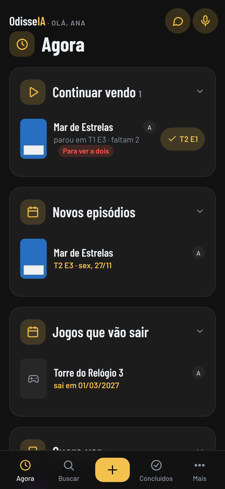
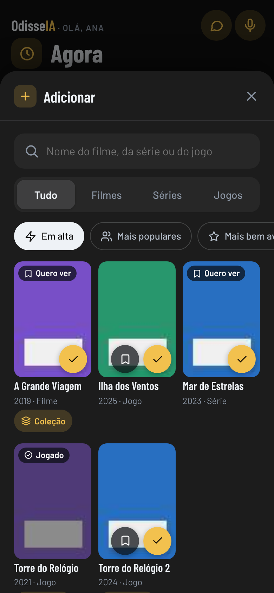
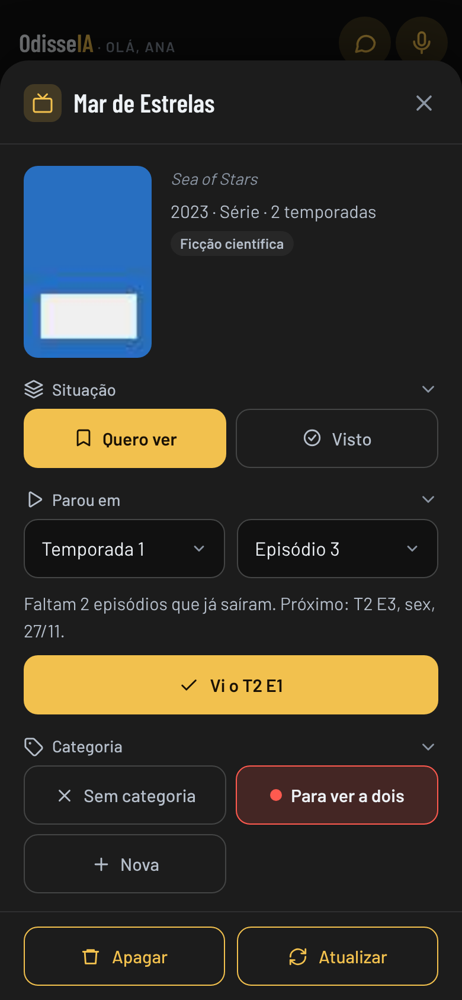
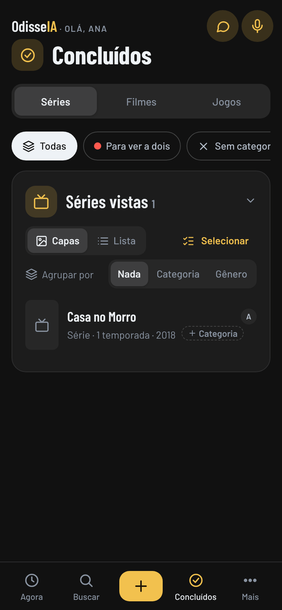

# OdisseIA


Um app (add-on) do Home Assistant para os filmes, as séries, os jogos e os livros da casa, da família de apps da CorrerIA Code.

<p align="center">
  
  
  
  
</p>

- **Agora**: o que a casa está vendo, o episódio em que cada um parou, os episódios e os jogos que vão sair e o que quer ver ou jogar.
- **Adicionar** pelo nome ou pelas listas prontas (em alta, mais populares, mais bem avaliados, estreias e coleções), com a capa: filmes e séries em português (TMDB), jogos (IGDB); uma série ou uma coleção inteira de uma vez.
- **Livros** (opcional): pelo nome, pelo autor ou pelo código de barras (ISBN), com a capa e o autor, da Open Library; Quero ler e Lido.
- **Situação, episódio, categoria (com cor), quem vê, onde assistir no Brasil** (dados da JustWatch) e **onde jogar**.
- **Buscar** e **Concluídos**, em capas ou em lista, agrupados por categoria ou gênero, com o Selecionar para mudar vários de uma vez.
- **IA**: a **Conversa** e o **Falar** no alto de toda tela, com a IA do Home Assistant; a Memória da IA da casa.
- **Pelo CorrerIA**: no WhatsApp, no Claude, no Gemini e na Ronda do lazer.
- **Sensores no Home Assistant**: Quero ver, as séries em andamento, o próximo episódio e o próximo jogo.
- Exportar, backup, importar e versões anteriores; tema claro e escuro e a cor da casa.

## Instalação

1. No Home Assistant: **Configurações → Aplicativos → Loja de aplicativos**.
2. No menu **⋮ → Repositórios**, adicione:
   ```
   https://github.com/diegozapella63/OdisseIA
   ```
3. Procure **OdisseIA** na loja, toque em **Instalar** e depois em **Iniciar**.
4. Ative **Mostrar na barra lateral** e ponha a chave grátis do TMDB em **Mais › Configurações › Integrações** (o passo a passo está na aba **Documentação**).

[](https://my.home-assistant.io/redirect/supervisor_add_addon_repository/?repository_url=https%3A%2F%2Fgithub.com%2Fdiegozapella63%2FOdisseIA)

## Desenvolvimento

```
python3 dev/rodar.py            # http://127.0.0.1:8099, com um TMDB e um IGDB de mentira (títulos e jogos inventados)
tests/run.sh                    # os testes (a tela precisa do playwright)
python3 tools/prints_readme.py  # refaz as capturas deste README (docs/*.png)
```

As instruções para quem mexe no código (pessoas ou IAs) estão em [AGENTS.md](AGENTS.md).

Este app usa a API do TMDB, mas não é endossado nem certificado pelo TMDB. Os jogos: dados do IGDB. Os livros: dados da Open Library.
